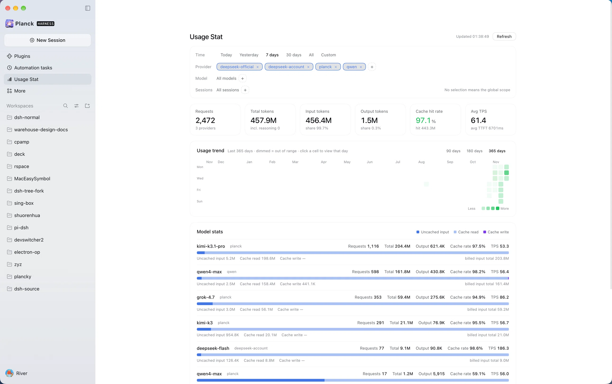
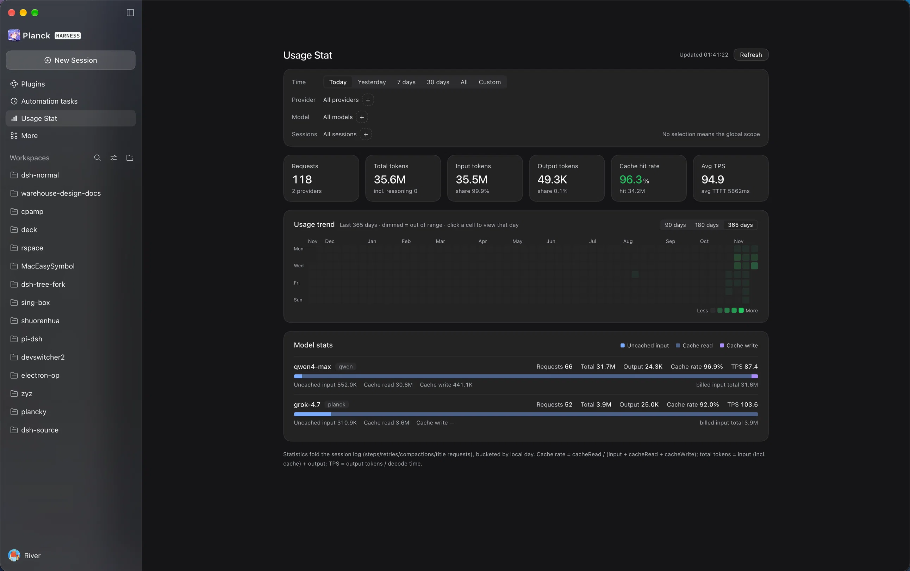

# dsh-usage-stat

English | [中文](README.zh.md)

Token usage statistics for [DeepSeek Harness](https://github.com/deepseek-ai/deepseek-harness). Adds a **Usage Stat** panel to the left sidebar — the same global-panel mechanism as Plugins.



<details>
<summary>Dark theme</summary>



</details>

## Features

- **KPIs** — request count (provider count; step/retry/compaction/aux breakdown on hover), total tokens (incl. reasoning), total input tokens with share, output tokens with share, cache hit rate, average TPS with TTFT.
- **Filters** — time presets (today / yesterday / 7 days / 30 days / all) plus a custom date range; provider, model, and session multi-selects. No session selection means the global scope.
- **Usage heatmap** — GitHub-style, 90 / 180 / 365-day windows (default 365). Cell size adapts to the panel width; click a cell to jump to that day; out-of-range days render dimmed.
- **Model stats** — per provider × model route: request count, total tokens, output, cache rate, TPS, and a disjoint input / cache-read / cache-write composition bar with the billed-input total.
- **Theme-friendly** — styling consumes `--dsw-alias-*` semantic tokens only, so light/dark and user-registered custom themes apply unchanged.

## Install

From the plugin market, or manually: **Plugins → Add plugin** and enter `dsh-usage-stat` (npm) or a local checkout directory. Requires DeepSeek Harness 0.2.x.

## How it counts

The host folds committed session events into a per-day, per-session, per-(provider, model) ledger:

| Kind | Source event | Notes |
|---|---|---|
| Steps | `step/end` | Attributed to the step's assistant-message route |
| Retries | `llm/retry-started` | An attempt actually dispatched after a failed request |
| Compactions | `compaction/summary` | With its provider-reported usage |
| Aux | `session/title-llm-request` | Title generation and other auxiliary calls |

Token buckets use the disjoint `TokenUsage` accounting:

- input excludes cache reads/writes; **cache hit rate** = cacheRead / (input + cacheRead + cacheWrite);
- **total tokens** = input (incl. cache) + output;
- **TPS** = output tokens / decode time; **TTFT** = step start → first non-empty text/reasoning delta, both derived from the timestamped stream embedded in `assistant/message`.

Reasoning tokens appear only for routes whose API reports them explicitly (e.g. DeepSeek reasoner); a zero means "not reported", not "no reasoning". Cache-write tokens appear only for APIs that report cache creation explicitly (e.g. Anthropic); implicit-prefix-cache providers report reads only.

### Durability

Every contributing event is appended to a JSONL ledger keyed by `(sessionId, seq)` with explicit history-coverage markers. Restarts replay it, and stored history is backfilled through `sessionPersistence`/`sessionQuery` without double-counting; gaps left by transient read failures heal on the next run. The ledger lives at `$DSH_PROFILE_DIR/usage-stat/ledger.jsonl` (or `~/.dsh/usage-stat/ledger.jsonl`), overridable via the row's `dataFile` config.

Deleting a provider or model never loses history: routes are recorded as strings at request time, and removed routes stay filterable.

An `llm/stream` waterfall listener adds real-time coverage for purpose-tagged auxiliary calls (title-call usage, failed compaction attempts, other declared purposes). Loop requests pass through untouched. The browser panel reads one authenticated route, `/usage-stat/api/snapshot`, and refreshes every 30 s.

## Known limitations

- Usage from attempts that never assembled an assistant message (e.g. cancelled mid-stream) is not counted; such steps are hidden from display as unknown routes.
- Auxiliary-call usage is counted only while the plugin runs; it cannot be backfilled from logs.
- Sessions in a format requiring migration are skipped by backfill.
- Day buckets use the Host's local timezone.

## Development

```sh
node tests/usage-stat.test.mjs   # fold, ledger, waterfall, client helpers
```

## License

MIT