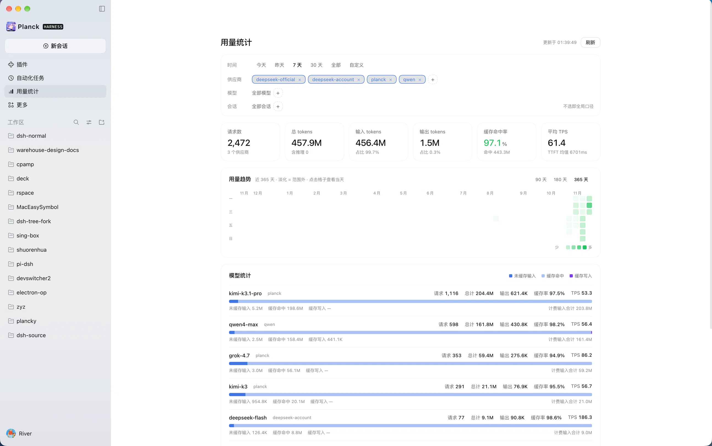
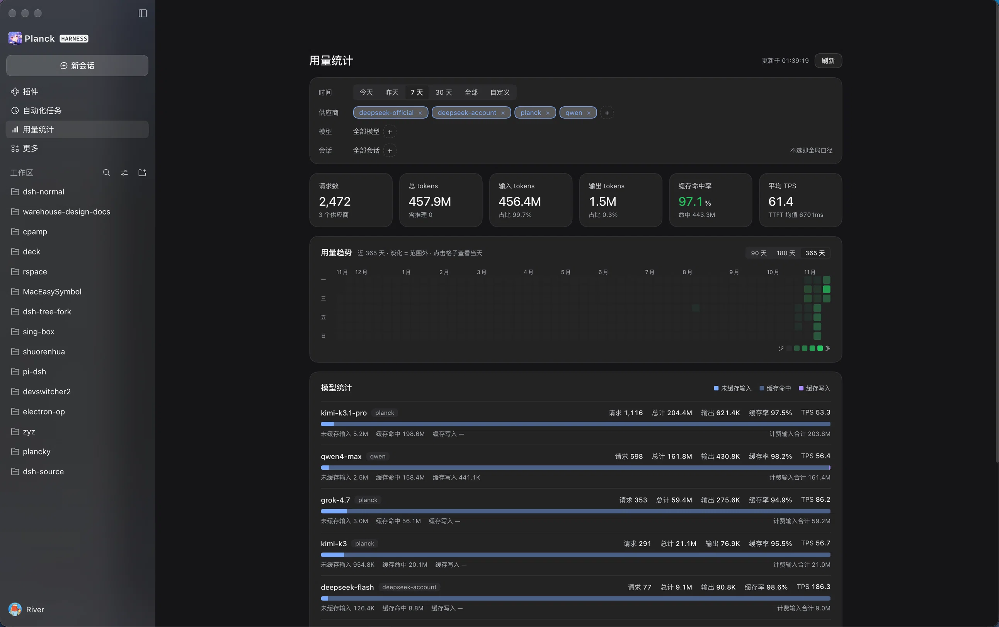

# dsh-usage-stat

[English](README.md) | 中文

[DeepSeek Harness](https://github.com/deepseek-ai/deepseek-harness) 的 token 用量统计插件。在左侧边栏新增「**用量统计**」全局面板——与「插件」同一套全局面板机制。



<details>
<summary>深色主题</summary>



</details>

## 功能

- **KPI 指标** — 请求数(供应商数量;悬停显示步/重试/压缩/辅助细分)、总 tokens(含推理)、输入 tokens 及占比、输出 tokens 及占比、缓存命中率、平均 TPS 与 TTFT。
- **筛选** — 时间预设(今天/昨天/7 天/30 天/全部)+ 自定义日期区间;供应商、模型、会话多选。不选会话即全局口径。
- **用量热力图** — GitHub 风格,90 / 180 / 365 天窗口(默认 365)。格子尺寸随面板宽度自适应;点击格子跳转到当天;范围外的日子淡化显示。
- **模型统计** — 按供应商 × 模型路由:请求数、总 tokens、输出、缓存率、TPS,以及互斥口径的未缓存输入/缓存命中/缓存写入构成条与计费输入合计。
- **主题兼容** — 样式只消费 `--dsw-alias-*` 语义令牌,浅色/深色与用户自定义主题自动生效。

## 安装

通过插件市场安装,或手动:**插件 → 添加插件**,输入 `dsh-usage-stat`(npm)或本地目录。需要 DeepSeek Harness 0.2.x。

## 统计口径

Host 将会话事件折叠为 按天 × 会话 × (供应商, 模型) 的账本:

| 类别 | 来源事件 | 说明 |
|---|---|---|
| 步 | `step/end` | 归因到该步 assistant 消息的路由 |
| 重试 | `llm/retry-started` | 失败后实际发出的重试请求 |
| 压缩 | `compaction/summary` | 含 provider 上报的用量 |
| 辅助 | `session/title-llm-request` | 标题生成等辅助调用 |

Token 采用互斥口径:

- 输入不含缓存读写;**缓存命中率** = 缓存命中 ÷ (未缓存输入 + 缓存命中 + 缓存写入);
- **总 tokens** = 输入(含缓存)+ 输出;
- **TPS** = 输出 tokens ÷ 解码时长;**TTFT** = 步开始 → 首个非空文本/推理增量,均取自 `assistant/message` 内嵌的带时间戳流记录。

推理 tokens 仅在 API 显式上报的路由显示(如 DeepSeek reasoner);为 0 表示"未上报",不代表没有推理。缓存写入仅在显式报告缓存创建的 API 出现(如 Anthropic);隐式前缀缓存的 provider 只报告命中。

### 持久化

每条贡献事件以 `(sessionId, seq)` 为键追加到 JSONL 账本,并带显式历史覆盖标记。重启时回放账本,历史会话经 `sessionPersistence`/`sessionQuery` 回填且不重复计数;偶发读取失败留下的缺口会在下次运行自愈。账本位于 `$DSH_PROFILE_DIR/usage-stat/ledger.jsonl`(或 `~/.dsh/usage-stat/ledger.jsonl`),可通过配置项 `dataFile` 覆盖。

删除供应商或模型不会丢失历史:路由在请求发生时以字符串定格,已删除的路由仍可筛选查看。

`llm/stream` waterfall 监听器为带 purpose 标签的辅助调用补充实时用量(标题调用用量、失败的压缩尝试等),主循环请求原样直通。浏览器面板读取认证路由 `/usage-stat/api/snapshot`,每 30 秒刷新。

## 已知限制

- 未组装出 assistant 消息的请求(如流中途取消)不计用量;此类步以未知路由隐藏,不参与显示。
- 辅助调用的用量仅在插件运行期计入,无法从日志回填。
- 需要格式迁移的旧会话跳过回填。
- 按天分桶使用 Host 本地时区。

## 开发

```sh
node tests/usage-stat.test.mjs   # 折叠、账本、waterfall、client 纯函数
```

## 许可证

MIT